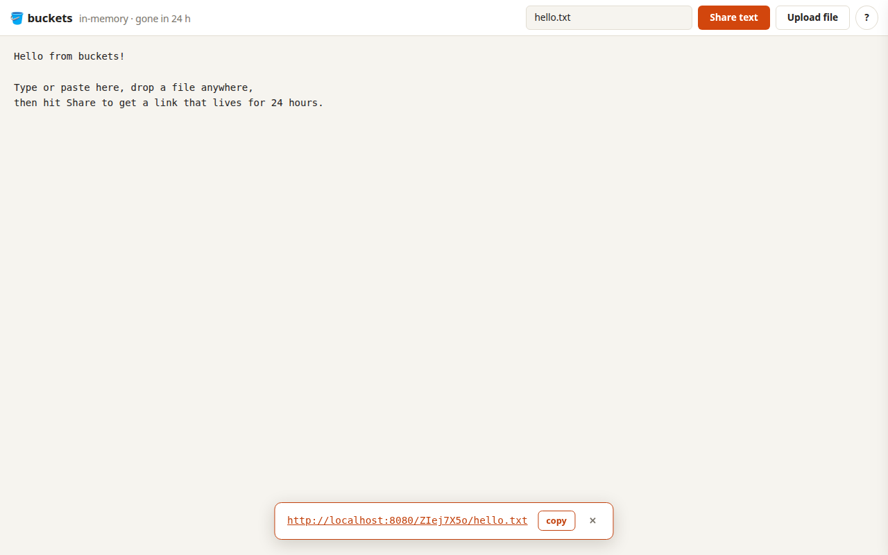

# 🪣 Buckets v2

A tiny in-memory pastebin with curl support, and a from-scratch rewrite of the
v1 line (preserved in this repository at the `v1-final` tag). One Go file,
stdlib only, one embedded HTML page, zero configuration.

Hosted on both [github.com/beleon/buckets](https://github.com/beleon/buckets) and
[codefloe.com/beleon/buckets](https://codefloe.com/beleon/buckets).

Share text or files from any machine:

```bash
$ curl --data "Hello, World" http://localhost:8080/hello.txt
http://localhost:8080/ky8tex25rD8/hello.txt
```

Or use the web UI:



## API

| Action   | Request                                | Notes                                        |
|----------|----------------------------------------|----------------------------------------------|
| Upload   | `POST /<filename>` with body           | Returns the bucket URL (`/<slug>/<filename>`) |
| Download | `GET /<slug>/<filename>` or `GET /<slug>` | Correct `Content-Type`, ranges, `HEAD`; the short form redirects |
| Replace  | `POST /<slug>/<filename>` with body    | Full path must match exactly; resets the TTL |
| Delete   | `DELETE /<slug>/<filename>`            |                                              |

`GET /` serves the web UI.

Filenames must be POSIX portable: 1–255 chars of `A-Z a-z 0-9 . _ -`, not
`.` or `..`, no leading `-`.

## Opinions (all hardcoded)

- **Port 8080**, plain HTTP. Put a reverse proxy in front for TLS.
- **24h TTL.** Replacing a bucket resets its clock.
- **500 MB max upload**, rejected while streaming with 413.
- **500 MB total storage.** When full, the oldest buckets are evicted.
- **Rate limits:** 12 POSTs/min, 240 requests/min for everything else (global,
  returns 429).
- **Slugs:** 15 Crockford base32 chars (75 bits from `crypto/rand`). The
  alphabet has no i, l, o or u, and lookups are case-insensitive and accept
  those lookalikes, so a slug survives being read aloud or retyped on
  another device. The slug is the whole secret (`GET /<slug>` redirects to
  the full path). Scanning at the rate limit for a year against a full
  store has about a 1 in 17 billion chance of hitting any bucket.
- **All in memory.** No disk, no database, nothing survives a restart.
- **Zero config.** URLs are derived from the request's `Host` header (and
  `X-Forwarded-Proto` if set). There are no environment variables.

## Build & run

```bash
go build && ./buckets
```

### Docker

```bash
docker build -t buckets .
docker run --rm -p 8080:8080 --memory 1.5g buckets
```

The image is `FROM scratch` with a single static binary (the web UI is
embedded). The server shuts down gracefully on SIGTERM. Memory budget:
500 MB store + in-flight upload bodies, so ~1.5 GB is a safe container limit.
The exception is piped uploads (`curl -T - ...`), which arrive chunked
without a known size and can peak near 2 GB for a max-size body: give the
container more room or write to a file first.

## Test

```bash
go test ./...
```

## License

MIT, see [LICENSE](LICENSE). The code was created with the help of
[Claude Code](https://claude.com/claude-code).
